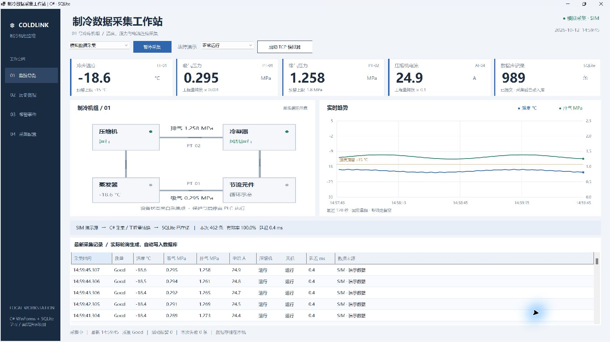
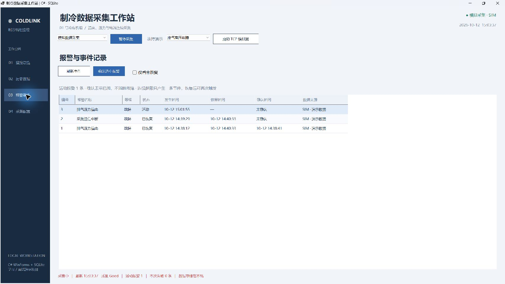
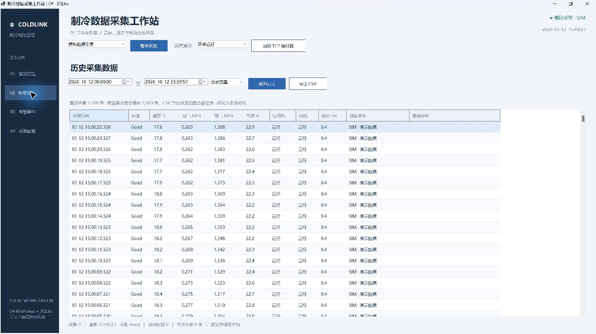
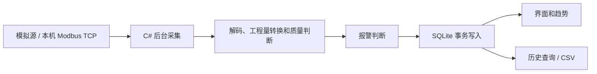

# 制冷上位机：数据采集与运行记录

用 C# WinForms 做的制冷机组监控程序。温度、吸排气压力、电流和设备状态每秒刷新一次，同时写入 SQLite。运行一段时间后，可以回查数据，也可以导出 CSV。

项目带有模拟数据源和本机 Modbus TCP 模拟器，不接设备也能演示采集、趋势、报警和存储。界面截图来自程序实际运行，图里的数值是模拟数据。



## 界面里能看什么

监控页显示冷库温度、吸排气压力、压缩机电流和数据库记录数。下方是机组循环示意图、最近 120 秒的趋势，以及每次采集的时间、质量、状态和通信耗时。

另外三个页面分别处理历史查询、报警记录和采集参数。采集在后台运行，切换页面时继续保存数据。

## 跑起来

直接试用：[下载 Windows x64 便携包](https://github.com/shitou2226/refrigeration-hmi/releases/download/v0.1.0-preview.1/RefrigerationHmi-0.1.0-preview.1-win-x64.zip)。完整解压，双击 `RefrigerationHmi.exe`。包内自带运行时，不用安装 SDK。首次启动会进入模拟采集，[按这几步试一遍](docs/quick-start.md)。

从源码运行需要 Windows 10/11 和 [.NET 9 SDK](https://dotnet.microsoft.com/download/dotnet/9.0)，在项目目录打开 PowerShell：

```powershell
dotnet run --project .\RefrigerationHmi.csproj -c Release
```

也可以用 Visual Studio 打开 `RefrigerationHmi.sln`。

如果想生成运行文件：

```powershell
.\build.ps1
```

生成后双击 `启动制冷上位机.cmd`，或运行 `dist\RefrigerationHmi.exe`。需要保留整个 `dist` 文件夹；换到其他电脑运行时，需要 .NET 9 Windows Desktop Runtime x64。

要制作与 Release 相同的自包含便携包，使用 PowerShell 7.4 或更新版本执行 `./scripts/build-portable.ps1`。脚本按锁文件还原依赖，附带许可证，生成校验清单，并在重新解压的目录运行 19 项自检。构建产物保存在 `artifacts/releases/`。

首次启动会自动建库并开始模拟采集。趋势从启动后的采集记录开始画，约两分钟填满窗口。

## 演示一遍

先让程序正常运行，观察数值、趋势和记录数一起变化。点击“暂停采集”，记录数就会停住，点“开始采集”继续。

然后在“故障演示”中选择“排气高压故障”。排气压力会超过设定值，报警页出现一条活动事件。故障持续时，这条事件不会每秒重复新增。点击确认会留下确认时间；切回正常运行后，才记录恢复时间。



再选“通信中断故障”。采集质量变成 `Bad`，温度、压力和电流显示为空，设备状态显示未知，曲线也会断开。数据库仍保存这次采集尝试和错误原因，方便回查断线发生的时间。

最后打开历史页，选时间范围，点击查询或导出 CSV。页面最多显示最新 5,000 条，CSV 会导出所选范围的全部记录。



## 看 Modbus 采集

点击“启动 TCP 模拟器”，再把左上角的数据来源切换为“本机 Modbus TCP”。程序会连接 `127.0.0.1:15020`，发送功能码 03 请求，读取 6 个寄存器，换算成工程量后显示并入库。

这时记录的来源是 `TCP · 127.0.0.1:15020`，延迟是实际通信耗时。停止模拟器可以观察连接失败，重新启动后采集会恢复。端口被占用时，到采集配置页更换端口即可。

模拟器只监听本机。当前代码没有接入真实 PLC，也没有设备启停、设定值下发等控制写入。

## 点表

功能码 03，起始地址 0，读取数量 6，双字节大端。下面是本项目的演示点表：

|协议地址|常见显示编号|变量|换算|
|---|---|---|---|
|0|40001|冷库温度|INT16 × 0.1 °C|
|1|40002|吸气压力|UINT16 × 0.001 MPa|
|2|40003|排气压力|UINT16 × 0.001 MPa|
|3|40004|压缩机电流|UINT16 × 0.1 A|
|4|40005|压缩机状态|0 停止 / 1 运行|
|5|40006|冷凝风机状态|0 停止 / 1 运行|

温度用有符号数，能读负温度。默认温度预警值为 -15 °C，排气高压值为 1.8 MPa，恢复回差分别是 0.5 °C 和 0.05 MPa。这些数值只用于演示，接设备时要重新核对工质、量程、点表和保护要求。

## 数据怎么保存



运行目录下的 `AppData/refrigeration.db` 有两张表：

- `samples` 保存每次采集尝试，包括时间、来源、质量、工程量、设备状态、延迟和错误说明。失败记录的数值是空值，不补成零，也不沿用上次读数。
- `alarms` 保存报警的发生、恢复和确认时间。通信失败时，已有的过程报警会保留，直到有效数据证明它已恢复。

采集记录与同次报警变化放在一个事务中提交。数据库使用 WAL 和参数化 SQL，时间以 UTC 保存，界面按电脑本地时间显示，CSV 使用 UTC。模拟与 TCP 记录都保留来源字段。

可以用 DB Browser for SQLite 查看表。备份前先正常退出程序，避免漏掉 WAL 中尚未合并的记录。目前没有自动清理历史数据，长时间运行需要自行安排归档。

## 代码放在哪

|文件|内容|
|---|---|
|`MainForm.cs`|页面、按钮、查询导出、采集启停|
|`VisualControls.cs`|数值卡、机组示意图和趋势绘制|
|`Acquisition.cs`|模拟源、Modbus 读取、本机模拟器、后台采集循环|
|`Domain.cs`|采集模型、参数和报警状态判断|
|`Repository.cs`|建表、事务写入、历史查询、报警确认、CSV 导出|
|`SelfTest.cs`|数据库与通信检查|

详细的复现步骤见 [演示说明](docs/demo.md)。

## 验证情况

Windows 本机 Release 构建通过，19 项自动检查通过。已操作验证模拟采集、TCP 采集、故障触发与恢复、历史查询、CSV 导出、参数保存、暂停和退出。

生成运行文件后，可以再跑一次检查：

```powershell
$test = Start-Process .\dist\RefrigerationHmi.exe -ArgumentList '--self-test' -Wait -PassThru -WindowStyle Hidden
$test.ExitCode
Get-Content .\dist\self-test-results.txt
```

检查使用临时数据库，不会修改运行数据库。具体范围见 [验证记录](docs/validation.md)。

目前验证到本机通信和数据存储。真实传感器、PLC、制冷机组及现场网络还未联调；机组联锁、急停和保护应由 PLC 完成。

## 许可

项目源码采用 [MIT 许可](LICENSE)。依赖通过 NuGet 还原，许可信息见 [第三方说明](THIRD_PARTY_NOTICES.md)。


## 试用与相关项目

[试用步骤](docs/try-it.md) · [反馈问题](https://github.com/shitou2226/refrigeration-hmi/issues/new/choose) · [其他电气与工业软件项目](docs/related-projects.md)
